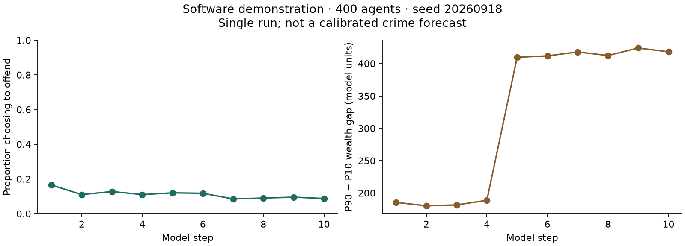

# Relative Desperation and Uncertainty

**An agent-based model exploring behavioral mechanisms of property crime.**

How might a person's position relative to neighbors interact with judgments of
uncertain outcomes? This model combines relative deprivation, probability
weighting, and stochastic choices in a spatial population. It is a mechanism
exploration, not a calibrated forecast of real-world offending.

**Methods:** Python · Mesa · behavioral decision theory · agent-based modeling ·
replicated simulation · sensitivity analysis · Slurm



**Status:** simulation code and cluster workflows are available. The figure is a
small single-seed software demonstration; full research-sweep results are not
included here. [Example data and provenance](examples/demo/README.md).

## Run a small example

Use **Python 3.11** with Mesa 3.3.1, the versions tested in CI and used for the research sweeps. From a terminal:

```bash
git clone https://github.com/blam3/ABM-relative-desperation-uncertainty.git
cd ABM-relative-desperation-uncertainty
python -m venv .venv
source .venv/bin/activate
pip install -r requirements.txt
python run.py --plot
```

On Windows, activate with `.venv\Scripts\activate`. The default run uses a
20×20 grid and 10 steps. Files appear in `outputs/demo/`:

- `model_data.csv`: offending proportion, mean wealth, P90–P10 wealth gap
- `metadata.json`: seed, run size, key parameters, and package versions
- `trajectories.png`: demonstration plot, excluding initialization

Add `--agent-data` for per-agent output. **Step 0 is initialization**, when all
choice indicators start at zero. Reproducing the earlier single-run scale is
explicit:

```bash
python run.py --width 100 --height 100 --steps 25 --seed 20260918 --out outputs/validation --agent-data
```

The entry point seeds both Mesa and the global NumPy/SciPy random stream.
Repeatability is checked within the installed environment; identical random
trajectories across package versions are not guaranteed. Independent processes
should be used for parallel replications because agent draws use global NumPy.

## Model in brief

1. Agents occupy a toroidal grid and compare wealth with sampled local neighbors.
2. Relative desperation shifts the reference point used to value outcomes.
3. Prelec probability weighting transforms the perceived odds of success.
4. A bounded softmax converts subjective values into stochastic choices.
5. Outcomes and living costs update wealth; agents update in shuffled order.

Under the default payoffs, offending has a negative expected monetary increment,
while law-abiding behavior pays a certain wage. Probability weighting, reference
points, nonlinear utility, **and decision noise** can all influence choices;
offending is not attributable to one mechanism merely because it occurs.

### Probability-weighting correction

The default is `w(p) = exp(-exp(beta) * (-ln(p))**alpha)`. At **beta = 0 and
alpha = 1**, weighting is the identity. The demonstration still draws heterogeneous
beta and alpha, so its population is not a no-distortion control.

The older `prelec_raw` option retains a historical parameterization that can
produce invalid weights when beta is nonpositive. It is for historical
comparison only, not the corrected default. See [PARAMETERS.md](PARAMETERS.md)
and [CHANGELOG.md](CHANGELOG.md) for assumptions and corrections.

## Verification

```bash
python -m unittest discover -s tests -v
python check_environment.py
```

Checks cover weighting bounds/identity/monotonicity, same-seed trajectories,
output invariants, and invalid demo sizes. CI also runs a small plot-producing
example. These are software/model checks, not empirical validation of the theory.

## Research-scale workflows

The batch scripts vary probability weighting, desperation thresholds, decision
noise, initial inequality, and alternative desperation rules. They write
replication-level summaries for analysis. Large per-agent outputs should stay
outside Git.

| File | Purpose |
|---|---|
| `cognitive_functions.py` | Utility, weighting, reference-point valuation, choice rule |
| `agents.py`, `model.py` | Agent behavior, spatial comparisons, model scheduling |
| `run.py` | Small seeded CLI example and optional exports |
| `batch_run_hpc.py` | Main replicated parameter sweep |
| `batch_run_sensitivity.py`, `batch_run_inequality.py` | Sensitivity designs |
| `batch_run_neighbor_sensitivity.py` | Comparison-group size sensitivity |
| `batch_run_lambda_sweep.py`, `analyze_lambda_sweep.py` | Desperation-severity (lambda) sweep and its diagnostic |
| `run_summary.py`, `aggregate_results.py` | Replication-level summaries and analysis |
| `analyze_for_manuscript.py`, `make_manuscript_figures.py`, `make_supplementary.py` | Manuscript tables and figures from the sweep summaries |
| `archive/` | June 2026 model code and the September 2026 pilot, kept for reproducibility |

Desperation severity defaults to lambda = 0.5 in `model.py`, `run.py` and
`batch_run_hpc.py` (it was 0.2 before 2026-11-18); `DMURD_LAMBDA` overrides it
for the batch scripts.
| `slurm/`, `CLUSTER.md` | Research-cluster submission instructions |

See [CLUSTER.md](CLUSTER.md) before running a full sweep. It is tailored to the
researcher's cluster, not a prerequisite for the local example. The Conda
alternative is `conda env create -f environment.yml` followed by `conda activate dmurd`.

## Limitations and next work

This repository explores behavior under specified assumptions, not estimated
individual risk. The example does not establish prevalence, causal effects of
inequality, or implications for policing or targeting individuals. Spatial
comparisons, the desperation rule, asynchronous updating, payoff settings,
and stochastic choice are substantive modeling assumptions.

Next work is to complete replicated research sweeps, report Monte Carlo
uncertainty, compare alternative mechanisms, and connect predictions to suitable
empirical evidence. The local example is intentionally too small to support
those conclusions. No full sweep was run during the presentation cleanup.

## Background and provenance

Research repository maintained by Brendan Lam. Historical revisions and
corrections are retained in [CHANGELOG.md](CHANGELOG.md); parameter rationale is
in [PARAMETERS.md](PARAMETERS.md). AI assistance was used in repository cleanup;
passing checks does not replace independent scientific review.

Selected background:

- Prelec (1998), [The probability weighting function](https://doi.org/10.2307/2998573).
- de Courson & Nettle (2021), [Why do inequality and deprivation produce high crime and low trust?](https://doi.org/10.1038/s41598-020-80897-8).
- Radkani et al. (2023), [Desperation and inequality increase stealing](https://doi.org/10.1098/rsos.221385).
- Jackson et al. (2017), [Agent-based modeling: A guide for social psychologists](https://doi.org/10.1177/1948550617691100).

If citing this research code, use the current repository URL and identify the
commit and parameterization:

> Lam, B. Relative desperation and uncertainty: an agent-based model of property
> crime [Research software]. https://github.com/blam3/ABM-relative-desperation-uncertainty
